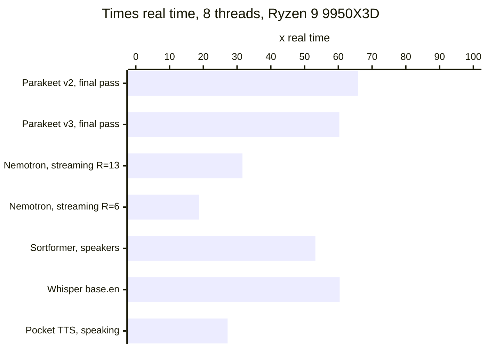

# gorelaxor

Run speech AI models natively in Go. No Python, no PyTorch, no cgo, no DLLs: `go get` it, point it at a model file, and it runs on the CPU at many times real time.

Three engines are in the box today:

| Package | What it does | Models |
|---|---|---|
| [`conformer`](conformer) | Speech to text (one pass or live streaming), who spoke when, overlapping speakers, silence detection | NVIDIA Parakeet TDT v2 and v3, Nemotron Speech Streaming, Nemotron 3.5 ASR, Multitalker Parakeet, Sortformer, MarbleNet |
| [`whisper`](whisper) | Speech to text in about 100 languages, translation to English | OpenAI Whisper, tiny to large-v3-turbo, in whisper.cpp's ggml files |
| [`pockettts`](pockettts) | Text to speech, streamed as it is made, and voice cloning from a short clip | Kyutai Pocket TTS, with 21 preset voices |

The NVIDIA and Kyutai engines are checked layer by layer against the original PyTorch code. Whisper is checked on recordings with known transcripts and against whisper.cpp. See [docs/ARCHITECTURE.md](docs/ARCHITECTURE.md#how-its-checked).

## Quick start

```
go get github.com/xattribution/gorelaxor
```

Transcribe a recording:

```go
pcm, _ := whisper.DecodeFile("talk.wav") // 16 kHz mono
m, _ := conformer.Load("parakeet-tdt-0.6b-v2-Q8_0.gguf")
vad, _ := conformer.LoadVAD("frame_vad_multilingual_marblenet_v2.0-F32.gguf") // cuts long recordings at pauses
toks, _ := m.Transcribe(pcm, vad, conformer.DefaultSegments, 4)
fmt.Println(m.TokenText(toks))
```

Live captions from a microphone:

```go
m, _ := conformer.Load("nemotron-speech-streaming-en-0.6b-Q8_0.gguf")
s, _ := m.NewStream(13, 2) // 1.12 s lookahead, 2 threads
for pcm := range mic {
	fmt.Print(m.TokenText(s.Write(pcm)))
}
```

Read text aloud:

```go
m, _ := pockettts.Load("pocket-tts-english_2026-09-Q8_0.gguf")
v, _ := m.LoadVoice("voice-alba.gguf")
m.Speak("The fog lifted by noon.", v, pockettts.Options{}, func(pcm []float32) error {
	return play(pcm) // 80 ms of 24 kHz audio at a time
})
```

The full runnable versions are the `Example` functions in each package. Command-line tools for trying a model are in `conformer/cmd/speech`, `whisper/cmd/transcribe` and `pockettts/cmd/speak`.

### Getting the model files

- **Whisper:** download a `ggml-*.bin` file from [ggerganov/whisper.cpp](https://huggingface.co/ggerganov/whisper.cpp) as is.
- **NVIDIA models:** download the `.nemo` file from Hugging Face, then run `python tools/convert_nemo.py model.nemo`. This needs PyTorch once, for the conversion only, and not NeMo.
- **Pocket TTS:** download Kyutai's files, then run `python tools/convert_pocket_tts.py model.safetensors`. This needs only numpy.

[docs/MODELS.md](docs/MODELS.md) lists every model with its size, languages, speed and license. The weights are not in this repository, and each model keeps its publisher's license.

## How fast

Speed is shown as times real time: 60x means an hour of audio takes a minute. These numbers come from a Ryzen 9 9950X3D on 8 threads, with the Q8_0 files.



On a 2-core cloud Xeon, Parakeet still runs at 8x real time and Pocket TTS at 3.9x. Loading a model takes under a second on the desktop and under 2 s on the Xeon. [docs/BENCHMARKS.md](docs/BENCHMARKS.md) has every model at 2, 8 and 16 threads, plus memory, accuracy and kernel throughput.

## Where it runs

It is pure Go, so it cross-compiles like any Go program; CI builds 11 targets. The fast kernels are written in amd64 assembly today. Other processors use the portable Go kernels, which give the same results but run about 30 times slower than the int8 path.

| Target | Builds | Tests | Fast kernels |
|---|---|---|---|
| Linux, Windows, macOS, FreeBSD on amd64 | ✓ | ✓ Linux and Windows | AVX2 + FMA, and int8 VNNI where the processor has it |
| Linux arm64 | ✓ | ✓ under emulation, and on a native runner in CI | not yet: NEON is next on the [roadmap](ROADMAP.md) |
| macOS on Apple silicon | ✓ | ✓ in CI | not yet |
| Android arm64, Windows arm64, RISC-V 64, WebAssembly (browser and WASI) | ✓ | not yet | portable Go only |

Reading audio files: WAV works everywhere, in Go. On Windows, MP3, M4A, AAC, WMA and the rest of what Windows plays also work, through the system's own Media Foundation.

## Documentation

- [docs/ARCHITECTURE.md](docs/ARCHITECTURE.md): how the engines, kernels and file formats work, and how each one is checked against the original.
- [docs/MODELS.md](docs/MODELS.md): the model library.
- [docs/BENCHMARKS.md](docs/BENCHMARKS.md): speed, memory and accuracy, and how to run `cmd/bench` on your own machine.
- [ROADMAP.md](ROADMAP.md): ARM kernels, more models, a public tensor API and GPUs.

## License

The code is under the Apache License 2.0 ([LICENSE](LICENSE)). Parts are Go translations of whisper.cpp, transcribe.cpp, NVIDIA NeMo and Kyutai's pocket_tts, and their notices are in [THIRD_PARTY_NOTICES.txt](THIRD_PARTY_NOTICES.txt). Model weights are not covered by this license: each model has its own, listed in [docs/MODELS.md](docs/MODELS.md).
