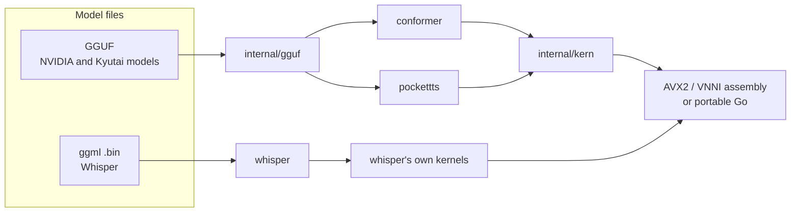
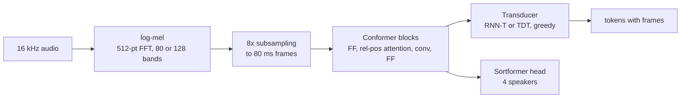
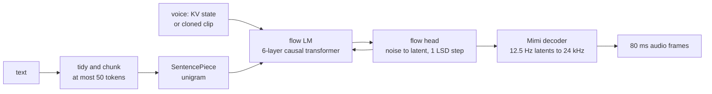

# How gorelaxor works

gorelaxor runs neural speech models with nothing but Go. This document covers the shared machinery (kernels, file readers, threading), each engine's pipeline, and how every engine is checked against the original implementation.

## Design rules

- **Pure Go.** There is no cgo, no Python and no external program. The one exception is optional: on Windows, `whisper.DecodeFile` reads non-WAV audio through the system's Media Foundation. A model is one file read into memory. An app that imports a package gets a single static binary that cross-compiles like any other Go program.
- **Match the original, then go fast.** Each engine is a step-by-step port of the reference code (NeMo, Kyutai's pocket_tts, whisper.cpp). The NeMo and Kyutai ports are tested against tensors saved from that code before any speed work, and Whisper against known transcripts.
- **Model files are untrusted input.** The readers check every size and offset. Loaders run a second of silence through the model before returning it. A panic in a worker goroutine comes back to the caller.
- **Streaming first.** Every engine that can work on live audio has a `Write` / `Close` stream, and the one-pass calls are built on the same code.

## Layout

```
conformer/        NVIDIA FastConformer family: ASR, streaming ASR, Sortformer, multitalker, MarbleNet VAD
whisper/          OpenAI Whisper from whisper.cpp's ggml files, plus WAV and Media Foundation audio decoding
pockettts/        Kyutai Pocket TTS: tokenizer, flow LM, flow head, Mimi codec, voice cloning
internal/kern/    matrix and vector kernels: float32, float16 and Q8_0 weights; AVX2 and VNNI assembly
internal/gguf/    GGUF reader
cmd/bench/        benchmark harness for every engine
tools/            converters (original weights to GGUF) and reference dumpers (original code's outputs)
```



## Kernels

Almost all of the time in these models goes to matrix products. Each one multiplies a weight matrix (rows = outputs, columns = inputs, the PyTorch `Linear` layout) by a batch of activation rows: one row per frame or token.

### Float products

`internal/kern` uses the same blocked GEMM as BLIS and ggml:

- **Micro-kernel:** 6 rows × 16 columns of the result, kept in twelve AVX2 registers, updated with FMA. It runs at about 47 GFLOP/s per core on a 2.8 GHz Xeon.
- **Packing:** the weight side is packed into 16-column panels. The activation side is cut into blocks 256 deep (`kc`) and 48 rows tall (`mc`), so a block stays in L1 and L2 while the panel streams past it.
- **Weight types:** float32 is used directly. Float16 is widened with F16C on the fly. Q8_0 rows (32 int8 values and one float16 scale, 34 bytes a block) are dequantized into the packing buffer.
- **Single rows:** a streaming or text-to-speech step often has one activation row. Then the speed is set by how fast the weights can be read from memory, not by arithmetic. On a 2-core Xeon, a 1024 × 1024 Q8_0 product runs at 18 GFLOP/s for one row and 249 GFLOP/s for 300 rows.

### Int8 products (VNNI)

On processors with VNNI (Intel 11th generation and newer, Xeon from Cascade Lake, AMD Zen 4 and newer), products with Q8_0 weights and two or more rows switch to an int8 path, as ggml does:

1. At load, each Q8_0 weight is repacked into **panels of 16 rows**. Each 640-byte block holds four consecutive values from each of the 16 rows, eight times over, then the 16 rows' scales, then a per-row sum that corrects for the unsigned activations. After packing, the original rows are released, so memory stays at about the file size.
2. At run time, the activation rows are rounded to Q8_0 as well.
3. One `vpdpbusd` instruction multiplies and accumulates 4 int8 pairs into each of 16 int32 lanes. That replaces eight float multiplies per block of 32.

This path is about five times as fast as the float path. The cost is that activations are rounded to 8 bits. The engines' encoders then differ from float32 by 1 to 4% RMS, and the transcripts stay word for word the same on 84 s and 306 s test talks.

### Portable path

Every kernel also exists in plain Go. The plain-Go versions run on processors without AVX2, on every non-amd64 target, and on amd64 when built with `-tags purego`. They give the same results as the assembly to float rounding, and they are about 6 times slower than the AVX2 float path and 30 times slower than VNNI ([BENCHMARKS.md](BENCHMARKS.md#kernels)). NEON kernels for arm64 are the first item on the [roadmap](../ROADMAP.md).

`whisper/` still has its own copy of the float kernels: `internal/kern` started as that copy, generalized to Q8_0. Moving Whisper onto `internal/kern` is on the roadmap. It would give Whisper Q8_0 weights in memory and the int8 path.

### Threads

Products split their output tiles across goroutines (`parallel` in `gemm.go`). Every call takes a thread count. 0 means all cores but one for the speech engines, and all cores for TTS. A panic in a worker is caught and re-raised on the caller's goroutine, so a caller's `recover` sees it. Loaded models are read-only and can be shared by goroutines. Streams and voices' per-call state belong to one goroutine at a time.

## File formats

**GGUF** (`internal/gguf`) holds the NVIDIA and Kyutai models. The reader handles format versions 2 and 3 and tensors in F32, F16, BF16 and Q8_0. It reads the whole file into one buffer. Tensors point into that buffer, or become `kern.Weight` values ready for the kernels. Every count, size and offset is checked against the file before it is used, and `hostile_test.go` feeds it truncated and lying headers.

`tools/convert_nemo.py` reads a `.nemo` archive (a tar of a YAML config and a PyTorch checkpoint) with PyTorch's safe loader. It folds batch norm into the preceding convolutions, works out the streaming cache sizes NeMo would compute, and writes GGUF. The tensor and setting names follow transcribe.cpp's layout, so transcribe.cpp can load these files too. `tools/convert_pocket_tts.py` reads safetensors itself (a JSON header and raw numbers) and needs only numpy.

**whisper.cpp's ggml format** holds Whisper. `whisper.Load` reads the hyperparameters, the mel filters, the vocabulary and the tensors in any of whisper.cpp's types. It holds every matrix as float16.

## The engines

### conformer: the FastConformer family



- **Front end:** NeMo's log-mel. The audio gets pre-emphasis, then a centered 512-point FFT with a 400-sample Hann window, then Slaney mel bands and log(x + 2^-24).
- **Encoder:** NeMo's ConformerEncoder. Depthwise-striding subsampling takes the audio to 80 ms frames. Then come blocks of feed-forward, relative-position self-attention, convolution and feed-forward.
- **Decoders:** RNN-T for Nemotron and Multitalker, and TDT with its duration head for Parakeet, both greedy. Nemotron 3.5 adds a language prompt: a small Linear-ReLU-Linear network over each frame joined with a one-hot language vector.
- **Final pass** (`Model.Transcribe`): recordings over 30 s are cut in MarbleNet's pauses. Each piece is encoded with full attention, and token frames are counted from the recording's start.
- **Streaming** (`Model.NewStream`): NeMo's cache-aware streaming. Chunks are R + 1 frames with R frames of lookahead. Each layer keeps a ring of its last attention inputs and its depthwise convolution's last kernel-1 frames.
- **Sortformer** (`Diarizer`): NeMo's streaming loop with its speaker cache and cache compression, giving four speakers' chances every 80 ms.
- **Multitalker:** Sortformer runs on each chunk, and each active speaker gets their own ASR stream, fed the chunk with that speaker's silent frames masked.
- **MarbleNet** (`VAD`): speech chances every 20 ms, turned into regions with NeMo's onset, offset, padding and minimum-duration rules.

### whisper

Audio is cut into 30-second windows. Each window becomes an 80-band (128 for large-v3) log-mel spectrogram. The encoder turns that into 1,500 positions. The decoder writes text with timestamps, following whisper.cpp:

- greedy decoding, with timestamp-pair rules and suppressed tokens
- a fallback to sampling at higher temperatures when the text loops or comes out unlikely
- a no-speech check
- seeking to the last timestamp, with earlier text passed along as context

An energy gate skips silence and steady noise before any of that runs. `Stream` decodes each window as soon as the audio runs past it, and gives exactly the text `Transcribe` would.

### pockettts



- **Text:** it is tidied and split at sentence ends, and long sentences are split again at commas. The tokenizer is tokenizer.json's SentencePiece unigram model, run the way Hugging Face tokenizers runs it.
- **Flow LM:** a 1024-wide causal transformer with rotary positions. It reads the voice prompt, the token embeddings, then one latent per 80 ms frame. Its output conditions a 6-block MLP flow head, which turns Gaussian noise into the next 32-value latent, plus an end-of-speech logit.
- **Mimi:** decodes each latent through a transposed convolution, a 2-layer transformer seeing 1.25 s back, and SEANet's upsampling. Everything is causal, so audio comes out one frame at a time.
- **Concurrency:** the flow LM runs on its own goroutine while the caller's goroutine decodes, as Kyutai runs its decoder on its own thread.
- **Voices:** a voice is the flow LM's keys and values after hearing a few seconds of a speaker, stored in a 2 to 4 MB file. `CloneVoice` makes one from a clip. It resamples the clip to 24 kHz, trims trailing silence, runs Mimi's encoder and projects the result into the flow LM.

## Memory

A model costs about its file size plus working space. With VNNI, the Q8_0 weights are repacked at load and their original rows freed, so that still holds: Parakeet and Nemotron hold about 750 MB each. Go lets the heap grow to about twice the live data before collecting. Apps that keep several models loaded should set a memory limit (`runtime/debug.SetMemoryLimit`). With a 900 MiB limit, Nemotron streamed a 5-minute talk in at most 0.9 GB.

## How it's checked

Each engine has a reference tool in `tools/` that runs the original code in float32 and saves its intermediate tensors. Tensors are saved as raw float32 files with a JSON shape beside each.

- **`tools/nemo_reference.py`:** NeMo for every conformer model, for one pass and for each streaming lookahead.
- **`tools/pocket_tts_reference.py`:** Kyutai's pocket_tts. It saves tokens, chunking, every flow-head call (transformer output, noise, latent, end-of-speech logit) and the audio, with and without voice cloning.
- **Whisper:** tested on recordings with known transcripts (short, long-form, streaming and translation), with word error rates compared to whisper.cpp's on LibriSpeech.

The Go tests compare against these when an environment variable names the folder: `GORELAXOR_CONFORMER_REF`, `GORELAXOR_POCKET_REF` and `GORELAXOR_WHISPER_MODELS`. Without one, the tests that need it skip. `go test ./...` always runs the self-contained tests: kernels against plain Go, the GGUF reader against hostile files, decoders, chunking and audio.

| Check | Largest difference from the original (float32 files) |
|---|---|
| Nemotron, one pass and streaming at R = 13, 6, 1, 0 | encoder 2e-5, same words |
| Nemotron 3.5, 7 languages, one pass and streaming | encoder 3.1e-5, prompt 5.1e-6, same tokens |
| Parakeet TDT v2 and v3 | encoder 3e-6, same words and token frames |
| MarbleNet | speech chance 1.1e-6 |
| Sortformer, 110 s | speaker chance 1e-6 |
| Multitalker, 2 speakers | speaker chance 6.6e-7, same words per speaker |
| Pocket TTS, teacher-forced | transformer 1.1e-6, latent 2.7e-6, audio 7.1e-6 (relative) |
| Pocket TTS tokenizer and chunking | identical on 20 awkward strings and 4 texts |

With Q8_0 files the conformer encoders differ from float32 by 1 to 4% RMS, and the words stay the same. Pocket TTS's quality gate with Q8_0 is a round trip: Parakeet must hear the same words in the Go audio as in Kyutai's float32 audio. `cmd/bench` runs the same round trip on any machine ([BENCHMARKS.md](BENCHMARKS.md#accuracy)).

## Adding a model

1. **Converter.** Write `tools/convert_<model>.py`, reading the original weights safely (safetensors or `torch.load(weights_only=True)`). It should write GGUF with the settings the engine can't infer from tensor shapes, and print the output's SHA-256.
2. **Reference.** Write `tools/<model>_reference.py`, running the original in float32 on the CPU and saving inputs, intermediate tensors and outputs.
3. **Port.** Port the forward pass onto `internal/kern` products. Load should check every tensor's shape against the settings and run a short silent input.
4. **Tests.** Compare layer by layer against the reference, first with the float32 file, then with Q8_0 against an end-to-end gate such as the same words or the same speaker turns.
5. **Speed.** Profile with `-cpuprofile` on the command-line tool, and add the model to `cmd/bench`.
