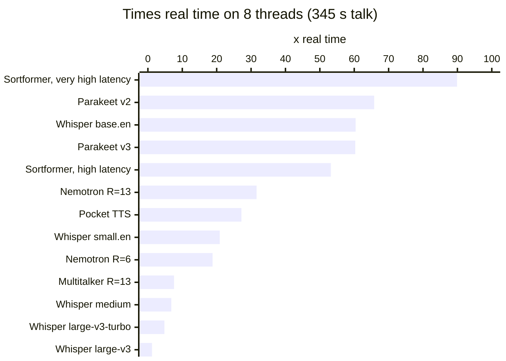
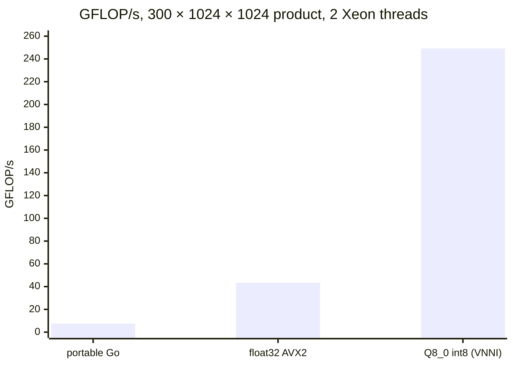

# Benchmarks

All numbers are times real time: seconds of audio handled per second of work. 60x means an hour of audio takes a minute. Files are Q8_0 unless noted. Whisper files are whisper.cpp's float16 ggml files.

## Desktop: Ryzen 9 9950X3D

- **Machine:** 16 cores, 32 threads, Zen 5 with AVX-512 VNNI, Windows 11.
- **Build:** Go 1.26, built with `GOOS=windows`.
- **Recording:** a 345-second talk.
- **Run:** `cmd/bench -threads 2,8,16`.



| Engine | Model | Mode | 2 threads | 8 threads | 16 threads | Load | Memory |
|---|---|---|---|---|---|---|---|
| conformer | Parakeet TDT 0.6B v2 | final pass, cut by MarbleNet | 31.9x | 65.8x | 66.9x | 0.34 s | 751 MB |
| conformer | Parakeet TDT 0.6B v3 | final pass, cut by MarbleNet | 30.0x | 60.3x | 63.1x | 0.36 s | 774 MB |
| conformer | Nemotron Streaming 0.6B | streaming, 1.12 s lookahead (R=13) | 20.9x | 31.6x | 30.3x | 0.35 s | 749 MB |
| conformer | Nemotron Streaming 0.6B | streaming, 0.56 s lookahead (R=6) | 13.6x | 18.8x | 18.8x | 0.36 s | 747 MB |
| conformer | Sortformer 4-speaker v2.1 | very high latency | 46.4x | 89.9x | 93.4x | 0.09 s | 159 MB |
| conformer | Sortformer 4-speaker v2.1 | high latency (10 s steps) | 28.4x | 53.2x | 53.1x | 0.09 s | 159 MB |
| conformer | Multitalker 0.6B + Sortformer | R=13, one stream per speaker | 4.5x | 7.6x | 7.3x | 0.69 s | 909 MB |
| conformer | MarbleNet VAD (F32) | silence detection | 2,818x | 7,393x | 8,696x | under 0.01 s | 5 MB |
| whisper | base.en | one pass | 30.9x | 60.4x | 68.2x | 0.08 s | 184 MB |
| whisper | small.en | one pass | 9.6x | 20.9x | 23.3x | 0.26 s | 579 MB |
| whisper | medium | one pass | 3.0x | 6.8x | 7.5x | 0.89 s | 1,753 MB |
| whisper | large-v3-turbo | one pass | 1.6x | 4.8x | 5.9x | 1.08 s | 1,617 MB |
| whisper | large-v3 | one pass | 0.7x | 1.2x | 1.3x | 1.89 s | 3,430 MB |
| pockettts | Pocket TTS, alba voice | speaking | 22.3x | 27.2x | 27.1x | 0.04 s | 145 MB |

Memory is the Go heap the model keeps after a run and a collection (`runtime.MemStats.HeapInuse`), measured with only that model loaded: the weights plus the state it holds between calls. A run's peak is higher. Whisper holds every matrix as float16, so its memory is the float16 file's size whatever the file's type.

What these show:

- **Real-time margin.** Every engine but Whisper large-v3 runs faster than real time on 2 threads, and most by 20x or more. A live caption stream, a speaker tracker and a TTS voice can run side by side on a few cores.
- **Thread scaling.** It levels off between 8 and 16 threads. The streaming models and TTS stop gaining earlier (by 8), because each step is a small product that waits on memory.
- **First audio.** Pocket TTS's first audio arrived after 0.03 s on 2 threads and 0.01 s on 8 or 16.
- **Voice cloning.** Cloning a voice from a 10 s clip took 0.26 s on 16 threads.

## Cloud: 2 cores of a 2.8 GHz Xeon

These are the earlier measurements in the package docs, on 2 threads. The AVX2 column is what processors without VNNI run (most Intel before 11th generation, and AMD before Zen 4). The VNNI column uses the int8 path.

| Engine | Mode | AVX2 | VNNI |
|---|---|---|---|
| Parakeet v2 | final pass, 84 s talk | 3.7x | 8.1x |
| Nemotron | streaming R=13 | 1.9x | 4.7x |
| Nemotron | streaming R=6 | 1.2x | 3.3x |
| Sortformer | very high latency | 8.4x | 14.1x |
| Sortformer | high latency | 5.1x | 8.6x |
| Multitalker | 2 speakers talking | 0.8x | 2.1x |
| Pocket TTS | 32-word passage | 3.1x (first audio 0.28 s) | 3.9x (first audio 0.06 s) |
| Whisper tiny.en | LibriSpeech | 17.9x | (no int8 path yet) |
| Whisper base.en | LibriSpeech | 9.6x | |
| Whisper small.en | LibriSpeech | 2.8x | |

For comparison on the same machine:

- whisper.cpp's AVX2 build took 14.5 s for two minutes of audio with base.en. This package took 12.7 s.
- Kyutai's own PyTorch Pocket TTS ran at 1.5x, against 3.9x here.

## Accuracy

### Round trip

`cmd/bench` needs no labeled audio. Pocket TTS reads a fixed 64-word passage aloud, and every speech-to-text model transcribes that recording. On the desktop run:

| Model | Word errors on the round trip |
|---|---|
| Parakeet v2, Parakeet v3 | 1.6%: 1 word of 64, "harbour" for "harbor" |
| Nemotron R=13 and R=6 | 0% |
| Whisper base.en, small.en, medium, large-v3-turbo, large-v3 | 0% |

This checks that the TTS output is intelligible and that each recognizer works end to end on the machine. It is not a substitute for a real test set.

### Real speech

| Model | Test | Word errors |
|---|---|---|
| Parakeet v2 | LibriSpeech, first 8.7 minutes | 2.35% (float path), 2.26% (int8 path) |
| Whisper tiny.en | LibriSpeech, 2 minutes | 9.9% (whisper.cpp: 10.6%) |
| Whisper base.en | LibriSpeech, 2 minutes | 9.1% (whisper.cpp: 27.7%, after it looped on one passage) |
| Whisper base.en | LibriSpeech, 8.7 minutes | 7.9% |
| Whisper small.en | LibriSpeech, 2 minutes | 8.0% |

These counts treat "Mr." against "MISTER" and the like as errors.

### Agreement with the original code

[ARCHITECTURE.md](ARCHITECTURE.md#how-its-checked) has the per-model differences from NeMo and Kyutai's PyTorch. With float32 files, the Go engines match to within 1e-6 to 3e-5, with the same words.

## Kernels

`go test -run '^$' -bench . -benchtime 20x ./internal/kern` measures GFLOP/s for the shapes the 0.6B models run, each on 2 threads.

| Product (rows × outputs × inputs) | Xeon: Q8_0 int8 | Xeon: float32 AVX2 | Xeon: portable Go | Ryzen 9950X3D: Q8_0 int8 | Ryzen 9950X3D: float32 AVX2 |
|---|---|---|---|---|---|
| 1 × 1024 × 1024 (one streaming row) | 17.8 | 10.6 | 4.1 | 107 | 96 |
| 8 × 1024 × 1024 | 78.5 | 23.1 | | 390 | 179 |
| 16 × 4096 × 1024 | 169 | 34.6 | | 666 | 227 |
| 300 × 1024 × 1024 (a 24 s offline piece) | 249 | 43.5 | 7.6 | 1,004 | 299 |
| 300 × 4096 × 1024 | 185 | 63.5 | | 1,001 | 285 |
| 300 × 1024 × 4096 | 226 | 57.7 | | 1,037 | 292 |
| 6 × 16 micro-kernel, one core | | 47.3 | 2.8 | | 173 |

The Xeon is 2 cores at 2.8 GHz with AVX-512 VNNI. The portable Go column was built with `-tags purego` and uses Q8_0 weights; float32 is the same, 7.1 GFLOP/s at 300 rows. On the Ryzen, the micro-kernel reaches 173 GFLOP/s on one core, close to what one Zen 5 core can do with 256-bit FMA (2 FMA units, 8 floats each).



The portable column is what arm64, RISC-V and WebAssembly run today. It is about 33 times slower than the int8 path, which is why NEON and `SDOT` kernels lead the [roadmap](../ROADMAP.md).

## Running it yourself

```
go build ./cmd/bench
./bench -models DIR -audio talk.wav -threads 2,8 -json results.json
./bench -models DIR -audio talk.wav -engines tts,whisper -whisper small.en,large-v3-turbo
```

`-models` is a folder holding any of the files in [MODELS.md](MODELS.md), under the names the converters and whisper.cpp use. The tool runs what it finds and prints one line per model, mode and thread count: load time, speed, memory and the round-trip word error rate. `-ref transcript.txt` adds a word error rate on `-audio` itself. Results from other machines are welcome, especially ARM ones.
