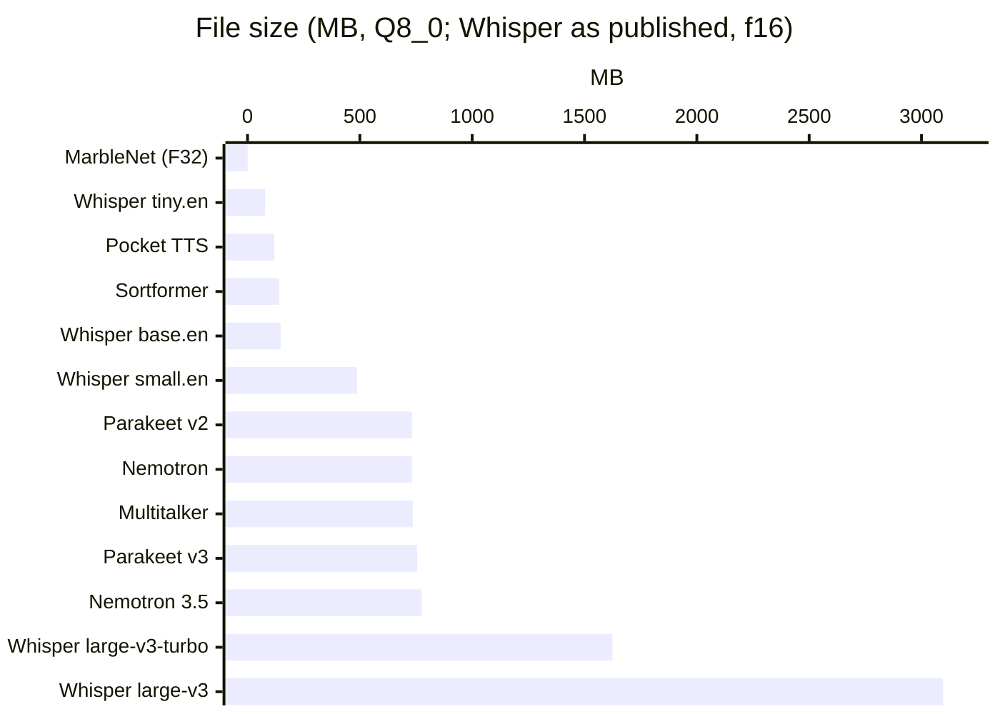

# Model library

Every model gorelaxor runs today, what it's for, and how close the Go engine comes to the original.

Model weights are not in this repository. Each model keeps the license its publisher gave it, listed here. The converters in `tools/` only change the file format.

## At a glance

| Model | Job | Languages | Parameters | File | Package | Weights license |
|---|---|---|---|---|---|---|
| [Parakeet TDT 0.6B v2](#parakeet-tdt-06b-v2-and-v3) | Final-pass speech to text | English | 600M | 732 MB | `conformer` | CC-BY-4.0 |
| [Parakeet TDT 0.6B v3](#parakeet-tdt-06b-v2-and-v3) | Final-pass speech to text | 25 European | 600M | 755 MB | `conformer` | CC-BY-4.0 |
| [Nemotron Speech Streaming 0.6B](#nemotron-speech-streaming-06b) | Live captions | English | 600M | 732 MB | `conformer` | NVIDIA Open Model License |
| [Nemotron 3.5 ASR Streaming 0.6B](#nemotron-35-asr-streaming-06b) | Live captions, language detection | 32 | 600M | 776 MB | `conformer` | OpenMDW-1.1 |
| [Multitalker Parakeet Streaming 0.6B v1](#multitalker-parakeet-streaming-06b-v1) | Overlapping speakers, one transcript each | English | 600M | 736 MB | `conformer` | NVIDIA Open Model License |
| [Sortformer 4-speaker v2.1](#sortformer-4-speaker-streaming-v21) | Who spoke when, up to 4 speakers | any | 117M | 140 MB | `conformer` | NVIDIA Open Model License |
| [MarbleNet frame VAD v2.0](#marblenet-frame-vad-multilingual-v20) | Speech or silence every 20 ms | any (trained on 6) | 91.5K | 0.4 MB (F32) | `conformer` | NVIDIA Open Model License |
| [Whisper](#whisper) tiny to large-v3-turbo | Speech to text, translation to English | about 100 (or English for `.en`) | 39M to 1.55B | 78 MB to 3.1 GB (f16) | `whisper` | MIT |
| [Pocket TTS english_2026-09](#pocket-tts) | Text to speech, voice cloning | English | 100M | 119 MB | `pockettts` | CC-BY-4.0 |

Q8_0 is ggml's 8-bit format: blocks of 32 int8 values sharing one float16 scale, 34 bytes for every 128 of float32. A converted file is a quarter to a third of float32's size, because some small tensors stay float32. On the test recordings it gives the same words as float32, except one Korean word that Nemotron 3.5 splits in two.

## Choosing a model

- **To transcribe a recording**, use Parakeet v2 for English and v3 for European languages. On 8 desktop threads Parakeet v2 runs about 14 times as fast as Whisper large-v3-turbo (65.8x against 4.8x). Whisper base.en is about as fast as Parakeet, but makes several times the errors (9.1% against 2.35% on LibriSpeech). Use Whisper for languages Parakeet doesn't cover, or for translation.
- **For live captions**, use Nemotron, or Nemotron 3.5 to cover 32 languages. The lookahead trades delay for speed. R = 13 waits 1.12 s and runs fastest. R = 6 waits 0.56 s.
- **To find who spoke when**, use Sortformer. Run it beside a speech-to-text model and match its turns to the words' times.
- **When people talk over each other**, use Multitalker with Sortformer. Each active speaker gets their own transcript.
- **To read text aloud**, use Pocket TTS. On a processor with VNNI the first audio comes back in tens of milliseconds, and in about 0.3 s without it, so it can start speaking while the text is still being written.
- **To skip silence or cut long recordings**, use MarbleNet. It is tiny: 2,800 times real time on 2 desktop threads. Parakeet's final pass uses it to cut recordings longer than 30 s.

## The models

### Parakeet TDT 0.6B v2 and v3

- **Source:** [nvidia/parakeet-tdt-0.6b-v2](https://huggingface.co/nvidia/parakeet-tdt-0.6b-v2), [nvidia/parakeet-tdt-0.6b-v3](https://huggingface.co/nvidia/parakeet-tdt-0.6b-v3)
- **Convert:** `python tools/convert_nemo.py parakeet-tdt-0.6b-v2.nemo` (also takes `--type f32` or `f16`)
- **API:** `conformer.Load`, then `Model.Transcribe`. `Model.Words` gives word times and confidences.
- **Architecture:** a 24-layer FastConformer encoder, with 8x subsampling to 80 ms frames, then a TDT transducer decoded greedily with its duration head.
- **Checked:** against NeMo in float32. The encoder matches to within 2.3e-6 for v2 and 3e-6 for v3, with the same words and token frames. v3 was checked on English, German, Spanish and French.
- **Accuracy:** 2.35% word errors on the first 8.7 minutes of LibriSpeech, or 2.26% on the int8 path.

### Nemotron Speech Streaming 0.6B

- **Source:** [nvidia/nemotron-speech-streaming-en-0.6b](https://huggingface.co/nvidia/nemotron-speech-streaming-en-0.6b)
- **API:** `Model.NewStream(R, threads)`, then `Stream.Write` with audio as it arrives and `Stream.Close` at the end.
- **How it streams:** cache-aware, as in NeMo. Chunks are R + 1 encoder frames with R frames of lookahead. R can be 13, 6, 1 or 0, which is 1.12 s, 0.56 s, 0.16 s or 0.08 s of delay. Each layer keeps its last 70 attention inputs and its convolution's last 8 frames.
- **Checked:** the encoder matches NeMo to within 2e-5 at every R, with the same words.

### Nemotron 3.5 ASR Streaming 0.6B

- **Source:** [nvidia/nemotron-3.5-asr-streaming-0.6b](https://huggingface.co/nvidia/nemotron-3.5-asr-streaming-0.6b)
- **API:** like Nemotron, plus `Model.WithLanguage("de-DE")` (or `"auto"`, the default) and `Model.DetectedLanguage`.
- **How languages work:** a language prompt joins each encoder frame through a small network before the decoder. In auto mode the model writes a language tag after each sentence. `Text` and `Words` leave the tags out.
- **Checked:** one pass on 7 languages in two modes, and streaming at R = 13 and 3. The encoder matches NeMo to within 3.1e-5 and the prompt to within 5.1e-6, with the same tokens. With the Q8_0 file, one Korean word comes out split in two.

### Multitalker Parakeet Streaming 0.6B v1

- **Source:** [nvidia/multitalker-parakeet-streaming-0.6b-v1](https://huggingface.co/nvidia/multitalker-parakeet-streaming-0.6b-v1)
- **API:** `conformer.NewMultiTalker(asr, diarizer, R, threads)`, then `Write`, `Close` and `SpeakerText`.
- **How it works:** NVIDIA's pipeline. Sortformer runs on each chunk, and each active speaker gets their own stream, fed the chunk with that speaker's silent frames masked.
- **Checked:** on a 2-speaker, 14 s mix, the speaker chances match NeMo to within 6.6e-7, with the same words for each speaker.

### Sortformer 4-speaker streaming v2.1

- **Source:** [nvidia/diar_streaming_sortformer_4spk-v2.1](https://huggingface.co/nvidia/diar_streaming_sortformer_4spk-v2.1)
- **API:** `conformer.LoadDiarizer`, then `Diarizer.Diarize` for a whole recording or `Diarizer.NewStream` for live audio. It gives each of four speakers' chances every 80 ms.
- **Settings:** `DiarVeryHighLatency`, `DiarHighLatency` (10 s steps, keeps up live on a CPU) and `DiarLowLatency`. These are NeMo's streaming loop with its speaker cache.
- **Checked:** over 110 s in very-high and low-latency modes, the speaker chances match to within 1e-6.

### MarbleNet frame VAD multilingual v2.0

- **Source:** [nvidia/Frame_VAD_Multilingual_MarbleNet_v2.0](https://huggingface.co/nvidia/Frame_VAD_Multilingual_MarbleNet_v2.0). It was trained on Chinese, English, French, German, Russian and Spanish, and works on speech in general.
- **API:** `conformer.LoadVAD`, then `VAD.ProbsLong` and `VAD.Speech` for speech regions, using NeMo's onset, offset, padding and minimum-duration rules.
- **Checked:** on a recording in noise, the speech chances match to within 1.1e-6.

### Whisper

- **Source:** [ggerganov/whisper.cpp](https://huggingface.co/ggerganov/whisper.cpp) on Hugging Face. Use the `ggml-*.bin` files as downloaded.
- **Sizes:** tiny, base, small, medium, large-v3 and large-v3-turbo. The `.en` versions are English only and a little more accurate in English.
- **Weights:** float32, float16, q4_0, q4_1, q5_0, q5_1 or q8_0. Every weight matrix is held as float16 in memory, so a quantized file is smaller on disk but uses the same memory.
- **API:** `whisper.Load`, then `Model.Transcribe` for a whole recording or `Model.NewStream` for live audio. `Options` takes the language, a prompt of words to expect, translation, and progress callbacks.
- **Decoding:** whisper.cpp's rules. Decoding is greedy, with timestamp pairs, suppressed tokens, a fallback to sampling when the text loops or comes out unlikely, and a no-speech check. An energy gate skips silence first, so an empty room doesn't come out as "Thank you."
- **Accuracy, LibriSpeech:** tiny.en 9.9%, base.en 9.1%, small.en 8.0% (2 minutes each). whisper.cpp scored 10.6% and 27.7% for tiny.en and base.en on the same audio, because base.en looped on one passage.

### Pocket TTS

- **Source:** [kyutai/pocket-tts](https://huggingface.co/kyutai/pocket-tts), the `english_2026-09` build with voice cloning.
- **Convert:** `python tools/convert_pocket_tts.py english_2026-09/model.safetensors`. It writes the model and one 2 to 4 MB file for each of the 21 preset voices.
- **API:** `pockettts.Load`, `Model.LoadVoice` or `Model.CloneVoice(pcm, rate, threads)`, then `Model.Speak` to stream or `Model.Synthesize` for the whole recording. `Options.Seed` makes the output repeatable.
- **Architecture:** a 6-layer causal transformer (the flow LM) conditions a small flow head. The flow head turns noise into one 32-value latent each 80 ms. Kyutai's Mimi codec decodes the latents to 24 kHz audio, one frame at a time.
- **Checked:** with each frame fed Kyutai's own latent, the transformer, the latents and the audio match Kyutai's float32 to within 1e-6 to 7e-6. Tokens and text chunks match exactly on 20 awkward strings.
- **Writing for it:** like Kyutai's code, it reads digits one at a time and breaks abbreviations at their periods. Spell numbers out ("twenty-five", not "25") before speaking. The `pockettts` package doc has a full table.

## File formats

- **GGUF** (version 2 or 3) for the NVIDIA and Kyutai models, in F32, F16, BF16 or Q8_0. `tools/convert_nemo.py` writes transcribe.cpp's tensor and setting names, so its files load in transcribe.cpp too.
- **whisper.cpp's ggml format** for Whisper.

Both readers check every size and offset against the file. Each loader also runs a second of silence through the model before returning it, so a damaged or mismatched file fails at load, not in the middle of a recording.

## Adding a model

See [ARCHITECTURE.md](ARCHITECTURE.md#adding-a-model). The pattern is a converter that writes GGUF from the original weights, a reference script that saves the original's outputs, and a Go port checked against those outputs layer by layer.
